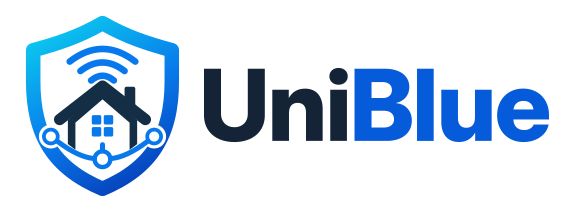
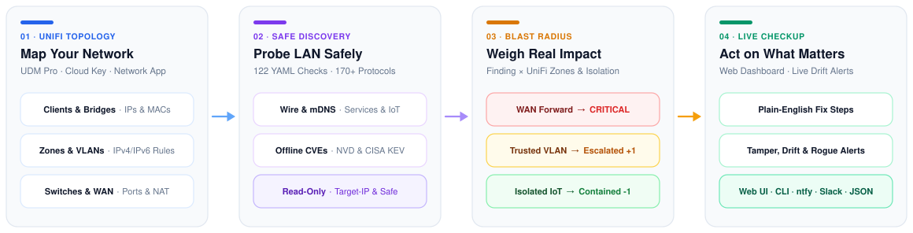

<p align="center">
  <picture>
    <source media="(prefers-color-scheme: dark)" srcset="docs/logo-horizontal-dark.svg">
    <source media="(prefers-color-scheme: light)" srcset="docs/logo-horizontal-light.svg">
    
  </picture>
  <br>
  <em>A friendly, read-only security checkup for your UniFi home or office network</em>
</p>

<br>

Most network scanners dump hundreds of cryptic port numbers and leave you guessing what actually matters. **UniBlue** connects to your UniFi gateway, gently checks the devices on your network, and answers three practical questions in plain English:

1. **What is on my network?** Every computer, phone, camera, smart-home gadget, switch cable, Wi-Fi network, and even downstream devices hidden behind an NVR or smart-home bridge.
2. **What services do they offer or use?** Real wire-verified services separated cleanly from local announcements (mDNS/UPnP), encrypted sockets, and outbound internet connections.
3. **What actually needs fixing, and how?** Plain-English steps in UniFi for open internet doors, exposed outdoor cables, leaky guest/IoT rules (across both IPv4 and IPv6), and known software security bugs.

<picture>
  <source media="(prefers-color-scheme: dark)" srcset="docs/how-it-works-dark.svg">
  <source media="(prefers-color-scheme: light)" srcset="docs/how-it-works-light.svg">
  
</picture>

## What makes UniBlue different?

- **Built for real humans, with full technical proof one click away:** The built-in web UI organizes your network into four calm tabs: **Checkup**, **House & Cables**, **Devices & Wi-Fi**, and **Activity**. Click any alert, device, cable port, or isolation check to slide open plain-English fix steps, with collapsible raw technical details underneath.
- **Knows your UniFi setup, not just raw ports:** A risky service on an isolated IoT network is very different from the same service sitting next to your personal laptop or forwarded to the internet. UniBlue reads your real UniFi networks, Firewall Zones, port forwards (matching exact TCP vs. UDP transport), and switch ports automatically.
- **Honest about what it knows:** UniBlue never flashes a fake green "all clear" while devices are still being checked, never invents "blocked" when the controller did not provide firewall or switch ACL evidence, and never guesses an application name behind opaque TLS or a shared CDN.
- **Gentle and strictly read-only:** Probes are rate-paced and read-only so fragile IoT gadgets (HVAC controllers, solar inverters, cameras) are not knocked offline. Raw print ports (`9100`, `515`, `_pdl-datastream`) have a hard zero-byte guard so UniBlue will never spit garbage pages out of your printer.
- **122 built-in checks + 170+ protocol recognizers:** Combines Praetorian's `nerva` fingerprinter with 122 declarative read-only YAML checks and wire protocol probes (covering smart-home gear, cameras/NVRs, printers, server BMCs, Bitcoin/Ethereum nodes, NUT UPSs, PJLink projectors, DNS/NTP/PCP/STUN, and more).

## Quickstart

You only need your UniFi console URL and a read-only credential. Networks, VLAN isolation tiers, and port hints are discovered automatically.

```sh
# 1. Build UniBlue
go build ./cmd/uniblue

# 2. Copy the example config and set your UniFi console URL (e.g. https://192.168.1.1)
cp config.example.yaml config.yaml

# Option A: Recommended for UDM Pro / Cloud Gateways (works with 2FA)
# In UniFi Network -> Settings -> Control Plane -> Integrations -> Create API Key
export UNIBLUE_UNIFI_API_KEY="your-local-api-key"

# Option B: Classic Cloud Key or local view-only account
# In UniFi Network -> Settings -> Admins & Users -> add a Local-Only View-Only admin
# export UNIBLUE_UNIFI_PASSWORD="your-local-readonly-password"

# 3. Start the live web dashboard (opens a clean UI at http://127.0.0.1:8080)
./uniblue serve -config config.yaml -listen 127.0.0.1:8080
```

Prefer the terminal or scheduled reports? Every feature works from the CLI too:

```sh
# Quick read-only inventory of your UniFi networks & devices (no LAN probing)
./uniblue inventory -config config.yaml

# Full one-shot security checkup in your terminal (add -json for structured output)
./uniblue scan -config config.yaml

# Audit every physical switch port, outdoor cable, and PoE drop
./uniblue ports -config config.yaml

# Export a self-contained offline HTML dashboard you can open or archive anywhere
./uniblue topology -config config.yaml -out network-checkup.html

# Run quietly in the background and notify only when something new changes
./uniblue watch -config config.yaml
```

> **Tip:** You can even skip `config.yaml` completely by setting `UNIBLUE_UNIFI_URL` and `UNIBLUE_UNIFI_API_KEY` in your environment.

## How UniBlue checks your network

### 1. Network isolation & shared services (IPv4 + IPv6)

UniBlue evaluates your actual UniFi Zone-Based Firewall rules in order, respecting IPv4 vs. IPv6, new vs. established return traffic, and whether a path is routed by your gateway or an L3 switch:

- **Approved workflows stay out of your way:** Declare intentional shared paths (like guests printing to an office IPPS printer on TCP 631) in `network.isolation_policy.approved_paths`. UniBlue verifies printing works while confirming printer admin pages stay blocked, leaving your action queue clear.
- **Catches subtle leaks:** Spots IPv6 rules that quietly bypass IPv4 blocks (for example, a guest network reaching a server BMC over IPv6), distinguishes UDP game forwards from TCP admin services sharing the same port number, and marks boundaries `unknown` whenever switch ACLs or firewall feeds are not available.

### 2. Outdoor cables & physical switch ports

UniBlue inspects every switch, gateway, and In-Wall AP port, including link state, VLAN tagging (`Block All` vs `Allow All`), PoE wattage, connected devices, and MAC port security:

- **Outdoor switches & feeder cables (`network.external_devices`):** Mark any switch or AP installed outside (garage, shed, exterior wall). UniBlue flags open unused sockets on it **and** traces the indoor feeder cable back to the parent switch so you know if an outdoor cable carries all of your home networks.
- **Live tamper & health alerts (`uniblue serve`):** Watches for physical link changes, PoE power drops (cable-swap indicator), inline hub MAC-table surges, STP loops, Evil-Twin Wi-Fi SSIDs, dormant devices waking up, wired/Wi-Fi swaps, and UniFi firewall or port-forward drift.

### 3. Declarative checks & safe protocol probes

Built-in checks live in `checks/generic/` and `checks/community/` and are compiled directly into the binary. You can add your own read-only YAML checks via `scan.checks_dir`:

```sh
# Validate all built-in + custom YAML checks (enforces strict read-only safety)
./uniblue check validate

# Test checks directly against a single IP on your LAN (no UniFi login needed)
./uniblue check test -target 192.168.1.42
```

### 4. Offline security bug (CVE) & hardware vendor databases

Sync the official NVD + CISA KEV vulnerability catalog (~38 MB) and IEEE MAC vendor tables (~550 KB) once, then match your UniFi firmware and LAN services completely offline:

```sh
# Sync local NVD + CISA KEV vulnerability cache (~17s first run, ~1s updates)
./uniblue cve sync

# Match your UniFi gear & LAN hosts against known vulnerabilities
./uniblue cve explore -config config.yaml

# Search or inspect any CVE offline
./uniblue cve search -vendor ui unifi
./uniblue cve show CVE-2026-9773

# Sync official IEEE hardware vendor tables for accurate device classification
./uniblue oui sync
```

### 5. Optional local feeds (NVRs, smart-home bridges, flows & switch ACLs)

Everything works out of the box with just your UniFi console. When you want deeper visibility into things UniFi cannot see directly, `config.example.yaml` shows how to plug in optional read-only local files:

- **`network.bridge_inventories`:** Attach downstream devices reported by an NVR (private-PoE cameras), Zigbee2MQTT, Z-Wave JS, Matter fabric, BLE proxy, or energy gateway as clickable child devices under their parent.
- **`network.passive_flows_path`:** Ingest Zeek `known_services`, IPFIX summaries, or JSON/YAML flow exports to enrich UDP/TLS service visibility and track outbound internet dependencies separately from local listeners.
- **`network.site_supplement_path`:** Supply controller-omitted telemetry such as switch ACL tables, reverse proxy routes, outbound publishing tunnels (Cloudflare Tunnel / Tailscale Funnel), active dynamic NAT leases, and backup freshness.

## Controller compatibility

UniBlue automatically detects how to talk to your UniFi console:

- **UniFi Network Integration API v1** (`X-API-Key`, recommended with 2FA): `/proxy/network/integration/v1/...`
- **UniFi OS** (UDM Pro, UDM SE, Cloud Gateways, modern Cloud Keys): `/api/auth/login` + `/proxy/network/...`
- **Classic Network Controller** (older Cloud Key / standalone Network App): `/api/login` + `/api/s/<site>/...`

## License

UniBlue is licensed under the [BSD 3-Clause License](LICENSE).
