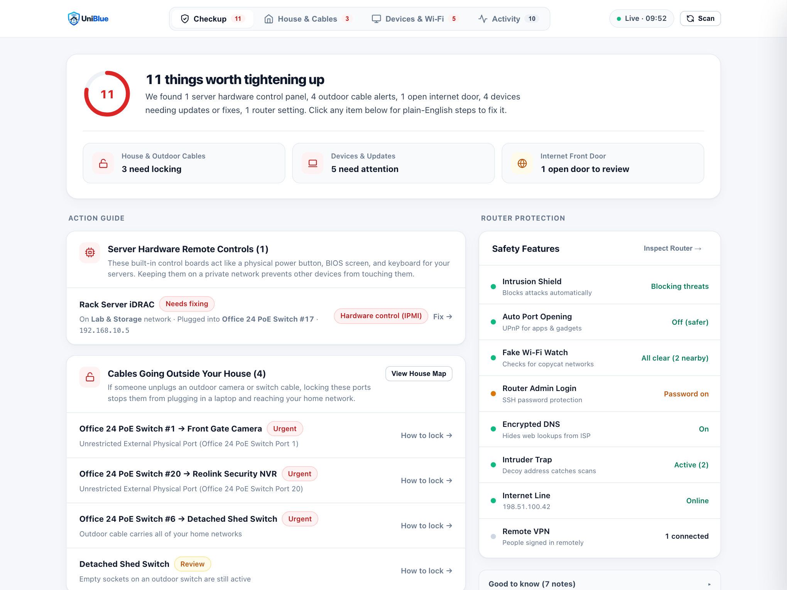

<p align="center">
  <picture>
    <source media="(prefers-color-scheme: dark)" srcset="docs/logo-horizontal-dark.svg">
    <source media="(prefers-color-scheme: light)" srcset="docs/logo-horizontal-light.svg">
    
  </picture>
  <br>
  <em>A friendly, read-only security checkup for your UniFi home or office network</em>
</p>

<br>

Most network scanners dump hundreds of cryptic port numbers and leave you guessing what actually matters. **UniBlue** connects to your UniFi gateway, gently checks the devices on your network, and answers in English:

1. **What is on my network?** Every computer, phone, camera, smart-home gadget, switch cable, Wi-Fi network, and even downstream devices hidden behind an NVR or smart-home bridge.
2. **What services do they offer or use?** Real wire-verified services separated cleanly from local announcements (mDNS/UPnP), encrypted sockets, and outbound internet connections.
3. **What actually needs fixing, and how?** Friendly steps in UniFi for open internet doors, exposed outdoor cables, leaky guest/IoT rules (across both IPv4 and IPv6), and known software security bugs.

<picture>
  <source media="(prefers-color-scheme: dark)" srcset="docs/how-it-works-dark.svg">
  <source media="(prefers-color-scheme: light)" srcset="docs/how-it-works-light.svg">
  
</picture>

## Demo

You can quickly look around in demo mode: `./uniblue demo -listen 127.0.0.1:8080`.

<picture>
  <source media="(prefers-color-scheme: dark)" srcset="docs/demo/checkup-dark.png">
  <source media="(prefers-color-scheme: light)" srcset="docs/demo/checkup-light.png">
  
</picture>

## What makes UniBlue different?

- **Human-first UI with full technical proof one click away:** The built-in web dashboard organizes your network into four calm tabs: **Checkup**, **House & Cables**, **Devices & Wi-Fi**, and **Activity**. Click any alert, device, switch port, or isolation check for clear fix steps, with collapsible raw technical details underneath.
- **UniFi-aware risk scoring:** An exposed service on an isolated IoT VLAN is very different from the same service sitting next to your personal laptop or forwarded to the internet. UniBlue reads your UniFi networks, Firewall Zones, port forwards (distinguishing TCP vs. UDP), and switch ports automatically.
- **Honest about what it knows:** UniBlue never flashes a fake green "all clear" while devices are still being checked, never assumes "blocked" when firewall or switch ACL telemetry is missing, and never guesses an application name behind opaque TLS or a shared CDN.
- **Gentle and strictly read-only:** Probes are rate-paced and read-only so fragile IoT gear (HVAC controllers, solar inverters, cameras) stays undisturbed. Raw print ports (`9100`, `515`, `_pdl-datastream`) have a hard zero-byte guard so UniBlue never prints garbage pages.
- **122 built-in checks + 170+ protocol recognizers:** Combines Praetorian's `nerva` fingerprinter with 122 declarative YAML checks and wire protocol probes covering smart-home gear, cameras/NVRs, printers, server BMCs, UPSs, projectors, Bitcoin/Ethereum nodes, DNS/NTP/PCP/STUN, and more.

## Quickstart

All you need is your UniFi console URL and a read-only credential. Networks, VLAN isolation tiers, and port hints are discovered automatically.

```sh
# 1. Build UniBlue
go build ./cmd/uniblue

# 2. Copy the example config and set your UniFi console URL (e.g. https://192.168.1.1)
cp config.example.yaml config.yaml

# Option A: Recommended for UDM Pro / Cloud Gateways (works with 2FA)
# In UniFi Network -> Settings -> Control Plane -> Integrations -> Create API Key
export UNIBLUE_UNIFI_API_KEY="your-local-api-key"

# Option B: Classic Cloud Key or local view-only account
# In UniFi Network -> Settings -> Admins & Users -> add a Local-Only View-Only admin
# export UNIBLUE_UNIFI_PASSWORD="your-local-readonly-password"

# 3. Start the live web dashboard at http://127.0.0.1:8080
./uniblue serve -config config.yaml -listen 127.0.0.1:8080
```

You can also skip `config.yaml` entirely by setting `UNIBLUE_UNIFI_URL` and `UNIBLUE_UNIFI_API_KEY`.

Prefer the terminal or scheduled checks? Every feature works from the CLI too:

```sh
# Quick read-only inventory of your UniFi networks & devices (no LAN probing)
./uniblue inventory -config config.yaml

# Full one-shot security checkup in your terminal (add -json for structured output)
./uniblue scan -config config.yaml

# Audit every physical switch port, outdoor cable, and PoE drop
./uniblue ports -config config.yaml

# Export a self-contained offline HTML dashboard you can open or archive anywhere
./uniblue topology -config config.yaml -out network-checkup.html

# Run quietly in the background and notify only when something new changes
./uniblue watch -config config.yaml
```

## How UniBlue checks your network

### 1. Network isolation & shared services (IPv4 + IPv6)

UniBlue evaluates your UniFi Zone-Based Firewall rules in order, respecting IPv4 vs. IPv6, new vs. established return traffic, and whether a path is routed by your gateway or an L3 switch:

- **Approved workflows stay out of your way:** Declare intentional shared paths (such as guests printing to an office IPPS printer on TCP 631) in `network.isolation_policy.approved_paths`. UniBlue verifies printing works while confirming printer admin pages stay blocked, keeping your action queue clean.
- **Catches subtle leaks:** Spots IPv6 rules that quietly bypass IPv4 blocks (such as a guest network reaching a server BMC over IPv6), separates UDP game forwards from TCP admin services sharing a port number, and marks boundaries `unknown` whenever switch ACLs or firewall feeds are unavailable.

### 2. Outdoor cables & physical switch ports

UniBlue inspects every switch, gateway, and In-Wall AP port, including link state, PoE wattage, connected devices, MAC port security, and VLAN tagging (`Block All` vs. `Allow All`):

- **Outdoor switches & feeder cables (`network.external_devices`):** Mark any switch or AP installed outside (garage, shed, exterior wall). UniBlue flags active unused sockets on it **and** traces the indoor feeder cable back to the parent switch so you know whether an outdoor cable carries all of your home networks.
- **Live tamper & health alerts (`uniblue serve`):** Watches for physical link changes, PoE power drops (cable-swap indicator), inline hub MAC-table surges, STP loops, Evil-Twin Wi-Fi SSIDs, dormant devices waking up, wired/Wi-Fi swaps, and UniFi firewall or port-forward drift.

### 3. Declarative checks & safe protocol probes

Built-in checks live in `checks/generic/` and `checks/community/` and are compiled directly into the binary. You can add your own read-only YAML checks via `scan.checks_dir`:

```sh
# Validate all built-in + custom YAML checks (enforces strict read-only safety)
./uniblue check validate

# Test checks directly against a single IP on your LAN (no UniFi login needed)
./uniblue check test -target 192.168.1.42
```

### 4. Offline security bug (CVE) & hardware vendor databases

UniBlue matches your UniFi firmware and LAN services against the official NVD + CISA KEV vulnerability catalog (~38 MB) and IEEE MAC vendor tables (~550 KB) completely offline. In `uniblue serve` mode (including Docker/Unraid), the local CVE cache is **automatically downloaded on first startup and checked hourly** in the background (configurable via `-cve-refresh 1h`, or `-cve-refresh 0` to disable auto-sync); unchanged feeds do zero work, and new CVEs are re-correlated in memory immediately without rescanning your LAN.

You can also sync or query the databases manually from the CLI:

```sh
# Sync local NVD + CISA KEV vulnerability cache manually (~17s first run, ~1s updates)
./uniblue cve sync

# Match your UniFi gear & LAN hosts against known vulnerabilities
./uniblue cve explore -config config.yaml

# Search or inspect any CVE offline
./uniblue cve search -vendor ui unifi
./uniblue cve show CVE-2026-9773

# Sync official IEEE hardware vendor tables for accurate device classification
./uniblue oui sync
```

### 5. Optional local feeds (NVRs, smart-home bridges, flows & switch ACLs)

Everything works out of the box with just your UniFi console. For deeper visibility into things UniFi cannot see directly, `config.example.yaml` shows how to attach optional read-only local files:

- **`network.bridge_inventories`:** Attach downstream devices reported by an NVR (private-PoE cameras), Zigbee2MQTT, Z-Wave JS, Matter fabric, BLE proxy, or energy gateway as clickable child devices under their parent.
- **`network.passive_flows_path`:** Ingest Zeek `known_services`, IPFIX summaries, or JSON/YAML flow exports to enrich UDP/TLS service visibility and track outbound internet dependencies separately from local listeners.
- **`network.site_supplement_path`:** Supply controller-omitted telemetry such as switch ACL tables, reverse proxy routes, outbound publishing tunnels (Cloudflare Tunnel / Tailscale Funnel), active dynamic NAT leases, and backup freshness.

## Where to run UniBlue

UniBlue is a single unprivileged Go binary (~30-50 MB RAM, no root or `CAP_NET_RAW` required), so you can run it on demand or leave it running 24/7:

- **On your laptop:** Fastest way to try UniBlue or run ad-hoc audits (`./uniblue serve`) with zero extra hardware. Monitoring stops when your laptop sleeps or leaves home, and cross-VLAN probes from a workstation can trigger your own UniFi IPS alerts.
- **In a Docker container:** Easy to run 24/7 on a server or NAS with a small volume for `config.yaml`, `state.json`, and the CVE/OUI cache. Use **`macvlan`** for a dedicated static IP and native mDNS/UPnP; default `bridge` blocks multicast and NATs probes behind the host IP, while `host` mode shares the host's IP in UniFi IPS logs.
- **In a VM or Proxmox LXC (recommended):** Gives UniBlue its own static LAN IP, OS isolation, native mDNS/UPnP (plus optional extra VLAN NICs), and clean per-IP UniFi firewall and IPS rules. LXC gives you VM-like networking with container-level memory overhead.
- **On a dedicated machine (Raspberry Pi or mini PC):** A standalone 24/7 appliance plugged into your switch on a fixed IP. Keeps catching cable swaps, new devices, and firewall drift even while your main server or hypervisor is down, at the cost of one more box to maintain.

### Integrating with AI agents

Running UniBlue 24/7 pairs naturally with an AI agent (such as Hermes) so you get notified of changes in real time, discuss findings in chat (Telegram, Slack, Discord), and verify fixes automatically:

- **Push alerts with Standard Webhooks signing:** Point `UNIBLUE_WEBHOOK_URL` (`notify.webhook_url`, default `format: "json"`) at your agent's webhook listener and set `UNIBLUE_WEBHOOK_SECRET` (`notify.webhook_secret`, accepting either a raw shared secret or padded `whsec_<base64>`). Each POST is signed using the Standard Webhooks v1 scheme (`webhook-id`, `webhook-timestamp`, and `webhook-signature: v1,<base64 HMAC-SHA256>`), with durable retries keeping the same `webhook-id` and re-signing fresh timestamps. Agents without persistent SSE listeners do not need to poll `/api/state`.
- **Inspect and verify via API:** Set `UNIBLUE_API_TOKEN` so your agent can authenticate with `Authorization: Bearer <token>` to query `GET /api/state` (findings, CVEs, topology, recent events) or subscribe to the live SSE stream at `GET /api/events`. Once you approve a fix (applied manually in UniFi or by your agent on a managed host), it can call `POST /api/rescan?ip=<ip>` to verify the issue is closed.
- **Keep your dashboard locked down on LAN:** Whenever `UNIBLUE_API_TOKEN` is set, `/api/*` requires either a Bearer token or an `HttpOnly` `SameSite=Strict` session cookie established through the built-in login prompt, with per-IP brute-force lockout (5 bad attempts within 15 minutes triggers a 15-minute lockout, escalating up to 1 hour). If you expose UniBlue behind a reverse proxy or custom domain, add that hostname to `UNIBLUE_ALLOWED_HOSTS` so DNS-rebinding Host checks permit it.

### Webhook events

With `format: "json"` (the default), each webhook POST sends `{"site", "summary", "diff"}` filtered by `min_severity` (default `medium`). Rapid live-event bursts coalesce over 15 seconds into one delivery, while new findings, CVEs, trusted devices, and port forwards dispatch immediately (merging any buffered live events).

| Payload field / `diff.events[].type` | Trigger |
| --- | --- |
| `diff.new_findings` | New security or posture finding at or above `min_severity` |
| `diff.escalated_findings` | Existing finding whose effective severity increased (e.g., host moved to a trusted VLAN or port-forwarded) |
| `diff.new_cves` | Newly matched High/Critical exact-version CVE or newly CISA KEV-listed CVE (includes `cve_id`, `product`, `version`, `cvss`, `kev`, `min_fixed_version`) |
| `diff.new_trusted_clients` | Previously unseen device joining a trusted VLAN |
| `diff.new_port_forwards` | Newly enabled WAN port-forwarding rule |
| `admin_activity` | UniFi console admin logins, account edits, and settings changes |
| `policy_changed` | Firewall policy or WAN port-forward rule set changed |
| `config_drift` | Controller security controls (SSH, UPnP, IPS, Honeypot, DoH, Teleport) or Wi-Fi SSID security changed |
| `honeypot_hit` | Internal LAN host probed UniFi's internal Honeypot |
| `port_link_up` / `port_link_down` / `port_config_changed` | Link or port-config changes on ports zoned `external`, `external_uplink`, or `unused` |
| `port_poe_tamper` | PoE device replaced by a non-PoE host on an `external` or `unused` port |
| `port_mac_surge` | Single-MAC access port jumped to 2+ MACs (possible inline hub or tap) |
| `wifi_evil_twin` | Unknown AP broadcasting one of your site's Wi-Fi SSIDs |
| `client_medium_swap` | Trusted-VLAN device switched between wired and Wi-Fi with the same MAC |

Intentionally kept on the dashboard/SSE only (not pushed to webhooks): WAN IPS/IDS blocked scanner traffic (`ids_threat`), internal port link/PoE/config flaps, STP blocks, dormant device wakeups, untrusted-VLAN joins/medium swaps, low/info findings, and resolved items.

### Environment variables (Docker / Unraid / zero-config)

UniBlue can run with a `config.yaml` or purely from environment variables (mount `/data` in Docker so `uniblue-state.json` and the auto-synced CVE cache under `/data/.cache/uniblue/cve` persist across container restarts):

| Variable | Required | Purpose |
| --- | --- | --- |
| `UNIBLUE_UNIFI_URL` | Yes | UniFi controller URL (e.g., `https://192.168.1.1`) |
| `UNIBLUE_UNIFI_API_KEY` | Yes* | UniFi local Integration API key (recommended with 2FA) |
| `UNIBLUE_UNIFI_USERNAME` / `UNIBLUE_UNIFI_PASSWORD` | *Fallback | Local view-only UniFi credentials (when not using an API key) |
| `UNIBLUE_UNIFI_SITE` | No | UniFi site ID (default: `default`) |
| `UNIBLUE_API_TOKEN` | Recommended | Shared secret protecting `/api/*` (Bearer auth for agents/scripts + login prompt cookie for browsers) |
| `UNIBLUE_ALLOWED_HOSTS` | Optional | Comma-separated reverse-proxy hostnames allowed past DNS-rebinding Host checks (IPs and `.local`/`.lan`/`.home` work automatically) |
| `UNIBLUE_WEBHOOK_URL` | Optional | Outbound alert webhook URL (for Hermes, ntfy, Discord, Slack, or custom receivers) |
| `UNIBLUE_WEBHOOK_SECRET` | Optional | Standard Webhooks signing secret (`whsec_<base64>` or raw string); omit to send unsigned |
| `UNIBLUE_WEBHOOK_FORMAT` | No | Payload format: `json` (default, recommended for agents), `ntfy`, `discord`, or `slack` |
| `UNIBLUE_WEBHOOK_MIN_SEVERITY` | No | Minimum severity to push: `info`, `low`, `medium` (default), `high`, or `critical` |

Useful `uniblue serve` flags: `-listen 0.0.0.0:8080`, `-reconcile 30m`, `-cve-refresh 1h` (`0` disables auto-sync), and `-no-cve`.

### Why not run UniBlue inside your agent?

Keeping UniBlue separate from your AI agent container or process is strongly recommended:

- **Blast-radius and credential isolation:** UniBlue needs a UniFi API key and L3 reachability across your VLANs (IoT, servers, cameras, BMCs). An LLM agent has shell, web, and chat access and a much larger prompt-injection surface; co-locating them exposes your UniFi credentials and internal VLANs to the agent.
- **Independent 24/7 uptime:** When you restart your agent, break a skill, or hit an LLM outage, a separate UniBlue container, VM, or appliance keeps monitoring your network and sending fallback alerts uninterrupted.
- **Clean read/write boundary:** Keep UniBlue strictly read-only on its own IP, expose only its narrow HTTP/webhook interface to your agent, and keep any remediation writes explicitly human-approved on the agent side.

## Controller compatibility

UniBlue automatically detects how to talk to your UniFi console:

- **UniFi Network Integration API v1** (`X-API-Key`, recommended with 2FA): `/proxy/network/integration/v1/...`
- **UniFi OS** (UDM Pro, UDM SE, Cloud Gateways, modern Cloud Keys): `/api/auth/login` + `/proxy/network/...`
- **Classic Network Controller** (older Cloud Key / standalone Network App): `/api/login` + `/api/s/<site>/...`

Wired and wirelessly meshed UniFi APs are supported. Ubiquiti's separate **AmpliFi** consumer line (HD, Instant, Alien) is not supported, as it does not run the UniFi Network API.

## Contributing

Pull requests are disabled on this repository. Whether you are a human or an AI agent, please open an issue for everything:

- **Features & bug fixes:** Describe the problem or feature clearly in an issue. UniBlue is built primarily with agents, so implementing changes directly from a well-scoped issue is simpler and faster than reviewing PRs.
- **New checks, device fingerprints & filters:** Open an issue with the relevant context or snippets (for example, the device model, open port/protocol, sample banner or HTTP response, or a draft YAML check snippet) and we will add it to the scanner.

## License

UniBlue is licensed under the [BSD 3-Clause License](LICENSE).
