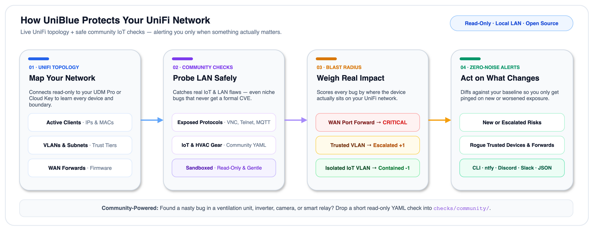

# UniBlue

UniBlue is a lightweight, deterministic **blue-team security agent for UniFi networks**.

It combines your UniFi gateway's live network topology (clients, VLANs, firmware, and WAN port forwards) with gentle LAN host probing and a declarative, community-submittable library of read-only IoT/LAN security checks.



*(Editable source: [docs/how-it-works.drawio](docs/how-it-works.drawio))*

## Why UniBlue?

- **UniFi blast-radius awareness:** A vulnerable ventilation controller or unauthenticated camera is scored differently depending on whether it sits on an isolated IoT VLAN, your trusted LAN, or behind an active WAN port forward.
- **Informal IoT/LAN bug registry:** Many nasty bugs in local hardware (HVAC systems, inverters, cameras, smart relays) never get a formal CVE. UniBlue lets anyone drop a safe, read-only YAML check into `checks/` and run it locally.
- **Gentle by design:** Fingerprinting uses a bounded worker pool, sequential per-host port checks with pacing, strict read-only verification probes, and target-IP-only sandboxing.
- **Low-noise alerting:** `uniblue watch` tracks baseline state in a local JSON file and only notifies you when something new appears, a finding escalates, an unknown device joins a trusted VLAN, or a new WAN port forward is enabled.

### Blast-Radius Severity Adjustments

A raw check severity is automatically adjusted using your UniFi topology:

| UniFi Context | Effect | Why |
| :--- | :--- | :--- |
| Affected host + port is **WAN port-forwarded** | **Force `CRITICAL`** | Directly reachable from the public internet |
| Device sits on a **`trusted_vlans`** network | **`+1` severity level** | High lateral-movement blast radius on your main LAN |
| Device sits on an **`isolated_vlans`** network | **`-1` severity level** | Already mitigated by IoT VLAN segmentation |

## Quickstart

```sh
# 1. Build
go build ./cmd/uniblue

# 2. Configure (copy and set your UDM Pro or Cloud Key URL)
cp config.example.yaml config.yaml

# Option A (UDM Pro / modern UniFi Network with 2FA):
# Create a key in UniFi Network -> Settings -> Control Plane -> Integrations
export UNIBLUE_UNIFI_API_KEY="your-local-integration-api-key"

# Option B (older Cloud Key or full legacy port-forward visibility):
# Create a Local-Only View-Only admin in Settings -> Admins & Users
# export UNIBLUE_UNIFI_PASSWORD="your-local-readonly-password"

# 3. Verify UniFi connectivity (read-only, no LAN probing)
./uniblue inventory -config config.yaml

# 4. Run a full scan
./uniblue scan -config config.yaml

# 5. Run continuously with webhook alerts on new/escalated findings
./uniblue watch -config config.yaml
```

## Working with Declarative Checks

Built-in checks live under `checks/generic/` and `checks/community/` and are embedded directly in the binary. You can add extra local or community checks in a separate directory via `scan.checks_dir` in `config.yaml`.

```sh
# Validate all built-in + custom YAML checks (enforces read-only & safety rules)
./uniblue check validate

# Test checks directly against one device on your LAN (no UniFi login needed)
./uniblue check test -target 192.168.1.42
```

## Controller Compatibility

UniBlue automatically detects how your UniFi console authenticates:
- **UniFi Network Integration API v1** (`X-API-Key`, recommended with 2FA enabled on your UI.com account) via `/proxy/network/integration/v1/...`
- **UniFi OS** (UDM Pro, UDM SE, Cloud Gateways, modern Cloud Keys) via `/api/auth/login` + `/proxy/network/...`
- **Classic Network Controller** (older Cloud Key Gen2 / standalone Network App) via `/api/login` + `/api/s/<site>/...`

Generate a local API key in **Settings → Control Plane → Integrations** (`UNIBLUE_UNIFI_API_KEY`), or create a **Local-Only View-Only admin** account (`UNIBLUE_UNIFI_PASSWORD`).
